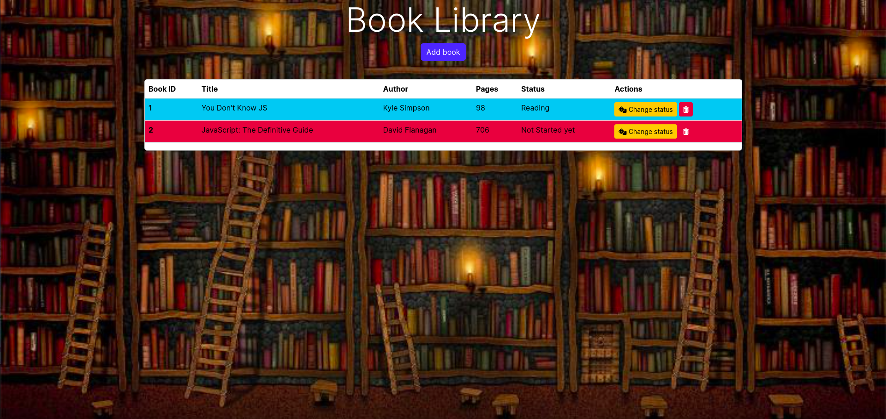

# Book-Library

This is a simple library web-based app where user can add books title, author name, number of pages and update current reading status.



## Technical tool

- JavaScript
- Html
- CSS
- Bootstrap
- React Bootstrap
- React Query
- React

## Setup

Create a `.env` file as mention below:

```
VITE_SERVER_URL=http://localhost:8000/
```

In separate terminals perform the following commands:

```sh
# Terminal 1
npm run server # this will start the json server
# Terminal 2
npm run dev # this will start the dev server
```
